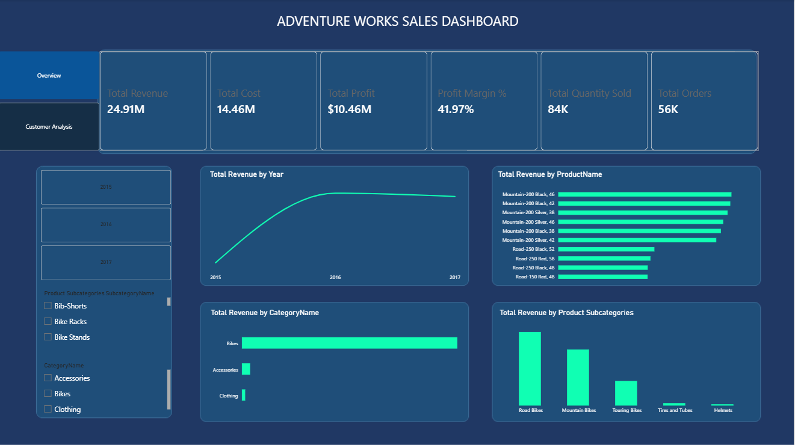

# Adventure Works Sales Dashboard

## Project Overview

This project focuses on analysing sales performance using **Microsoft SQL Server and Power BI**. SQL Server serves as the primary data source, while Power BI is used for data modelling, analysis, and interactive dashboard development.

The dashboard provides insights into revenue, costs, profitability, sales quantities, orders, and product performance across different years and product categories.

## Dashboard Preview

## Key Performance Indicators (KPIs)

The dashboard presents six key business metrics:

| Metric | Value |
|---|---:|
| Total Revenue | $24.91M |
| Total Cost | $14.46M |
| Total Profit | $10.46M |
| Profit Margin | 41.97% |
| Total Quantity Sold | 84,174 |
| Total Orders | 56,046 |

## Dashboard Features

### 1. Sales Performance Analysis
- Tracks total revenue across different years.
- Identifies revenue trends and changes over time.

### 2. Product Performance Analysis
- Compares revenue generated by individual products.
- Identifies products contributing significantly to overall sales.

### 3. Category Analysis
- Evaluates revenue contribution across:
  - Bikes
  - Accessories
  - Clothing

### 4. Subcategory Analysis
- Breaks down sales performance across product subcategories.
- Includes Road Bikes, Mountain Bikes, Touring Bikes, Tires and Tubes, and Helmets.

### 5. Interactive Filtering
The dashboard includes interactive slicers that allow users to filter data by:
- Year
- Product Category
- Product Subcategory

### 6. Customer Analysis
A separate Customer Analysis page provides an additional perspective for exploring customer-related business insights.

## Tools and Technologies

- **Microsoft SQL Server:** Database management and primary data source.
- **SQL:** Working with and querying relational data.
- **Microsoft Power BI:** Data modelling, analysis, and interactive visualisation.

## Data Integration Workflow

The project combines SQL Server and Power BI through the following workflow:

1. Data is stored and managed in Microsoft SQL Server.
2. Power BI connects to SQL Server as its data source.
3. Data is brought into the Power BI environment for analysis.
4. Business metrics and report visualisations are developed.
5. Interactive filters allow users to explore sales performance from different perspectives.

## Skills Demonstrated

- SQL Server database connectivity
- SQL and relational database concepts
- Power BI data modelling
- Business intelligence and reporting
- KPI development and analysis
- Sales and product performance analysis
- Interactive dashboard development
- Data visualisation and storytelling

## Project Objective

The objective of this project is to demonstrate how SQL Server and Power BI can be integrated to transform business data into meaningful insights.

By combining database management, data analysis, and business intelligence, the dashboard provides a consolidated view of sales performance and supports data-driven decision-making.
roject: Adventure Works Sales Dashboard
Data Source: Microsoft SQL Server
Visualisation Tool: Microsoft Power BI
